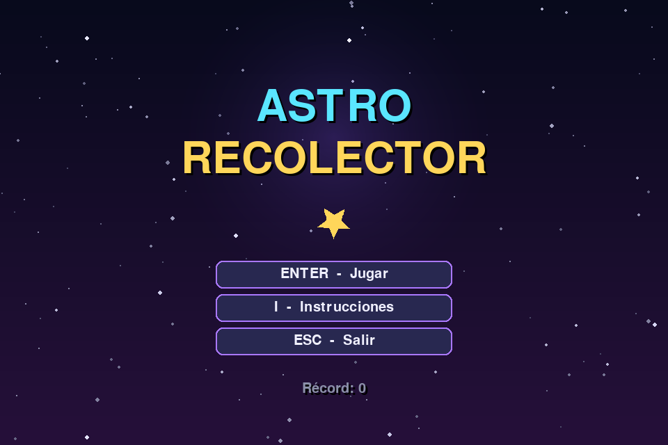
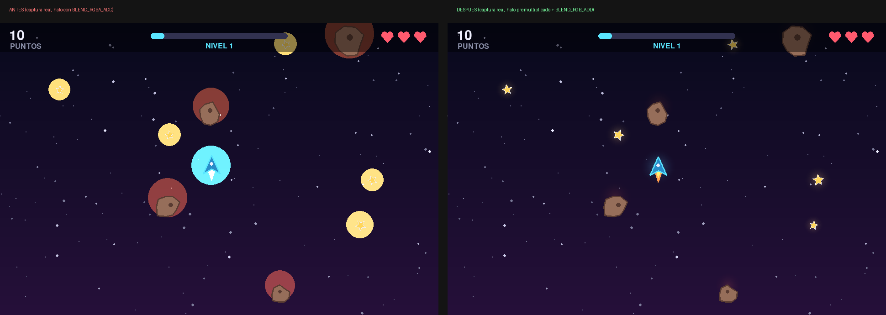
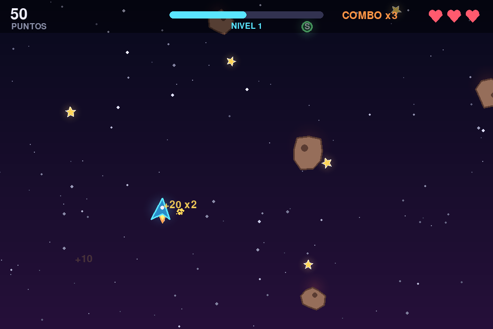
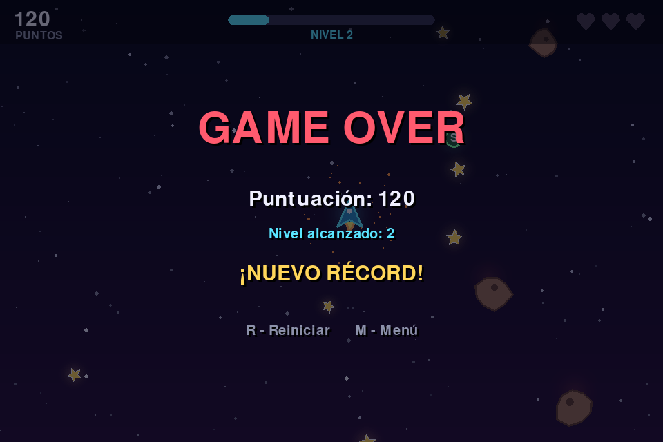

# Astro Recolector

**Actividad:** Vibecoding Guiado — Desarrollo de una Aplicación o Mini-Juego con IA como Copiloto
**Tecnologías:** Python 3 · Pygame (`pygame-ce`) · pytest
**Plataforma verificada:** Windows 11 (Python 3.14.7, pygame-ce 2.5.8) y Linux (lógica, Python 3.13)



---

## Índice

- [A. Descripción del proyecto](#a-descripción-del-proyecto)
- [B. Prompts utilizados](#b-prompts-utilizados)
- [C. Iteraciones](#c-iteraciones)
- [D. Validación](#d-validación)
- [E. Comprensión del código](#e-comprensión-del-código)
- [F. Reflexión final (borrador para revisión personal)](#f-reflexión-final-borrador-para-revisión-personal)
- [Estructura de archivos](#estructura-de-archivos)

---

## A. Descripción del proyecto

### Nombre
**Astro Recolector**

### Objetivo
Demostrar el desarrollo completo de un mini-juego 2D usando una IA como copiloto: planificación, implementación, mejoras iterativas justificadas, pruebas automatizadas y documentación.

### Descripción
Pilotas una pequeña nave en un cielo nocturno. Caen estrellas que debes recoger y meteoros que debes esquivar. Encadenar estrellas rápido multiplica la puntuación (combo hasta ×5) y de vez en cuando aparece un escudo que absorbe un choque. Cada 100 puntos sube el nivel: los meteoros son más rápidos y frecuentes. Ganas al llegar a 1000 puntos; pierdes al quedarte sin vidas.

Todos los gráficos se generan por código con Pygame (polígonos, círculos, degradados, superficies con mezcla aditiva). No hay imágenes ni sonidos externos.

### Mecánicas

| Mecánica | Detalle |
|---|---|
| Movimiento | 8 direcciones, velocidad constante (diagonal normalizada), la nave no sale de la pantalla |
| Estrellas | +10 puntos × combo actual |
| Combo | Cada estrella recogida en menos de 1,6 s desde la anterior sube el multiplicador (máx. ×5); se pierde al chocar o al esperar |
| Meteoros | Tamaño, velocidad y giro aleatorios; un choque cuesta 1 vida y da 1,5 s de invulnerabilidad (la nave parpadea) |
| Escudo (esfera verde "S") | Aparece cada 14 s; absorbe el siguiente choque |
| Dificultad progresiva | Nivel = 1 + puntos // 100. Velocidad de meteoros +28 px/s por nivel; intervalo de aparición −0,09 s por nivel (mínimo 0,28 s) |
| Victoria / derrota | Victoria al llegar a 1000 puntos · Game Over con 0 vidas |
| Récord | Se guarda en `highscore.json`, junto al proyecto |

### Controles

| Tecla | Acción |
|---|---|
| Flechas o W A S D | Mover la nave |
| ENTER / ESPACIO | Jugar (desde el menú o las instrucciones) |
| I | Instrucciones (desde el menú) |
| P | Pausa / continuar |
| R / ENTER | Reiniciar (en Game Over o Victoria) |
| M | Volver al menú (en Game Over o Victoria) |
| ESC | Volver al menú · en el menú: salir |

### Instalación (Windows)

1. Instala Python 3.10 o superior desde <https://www.python.org/downloads/> (marca "Add Python to PATH").
2. Abre una terminal en la carpeta del proyecto e instala las dependencias:

```bat
py -m pip install -r requirements.txt
```

> Se usa `pygame-ce` y no `pygame` porque el paquete `pygame` clásico no tiene binarios para Python 3.14 y su instalación falló en la prueba real (ver [Iteración 4](#iteración-4--correcciones-detectadas-al-ejecutar-en-windows)). `pygame-ce` se importa igual (`import pygame`). Si ya tienes instalado `pygame`, desinstálalo antes (`py -m pip uninstall pygame`) para evitar conflictos.

### Ejecución

```bat
py main.py
```

O doble clic en **`jugar.bat`** (instala Pygame si falta y lanza el juego).

Otros modos:

```bat
py main.py --prueba-humo 600        :: ejecuta 600 fotogramas sin ventana y recorre todos los estados
py main.py --capturas evidencias    :: demo automática que guarda capturas reales
py -m pytest -v                     :: pruebas automatizadas
```

**`ejecutar_pruebas_y_capturas.bat`** hace todo lo anterior de una vez y guarda los resultados en `evidencias/`.

En Linux/macOS los comandos son los mismos cambiando `py` por `python3`.

---

## B. Prompts utilizados

**Contexto honesto del proceso.** El proyecto lo desarrolló un agente de IA (Claude, en modo agente autónomo) a partir de **un único prompt maestro** del estudiante, que pedía desarrollar el juego completo por fases (planificación, implementación, refinamiento con tres tipos de mejora, pruebas y entrega). Los cinco "prompts" siguientes son las **instrucciones de trabajo concretas** que el agente formuló y ejecutó en cada fase, redactadas aquí con claridad. No son una transcripción de una conversación con turnos separados; sí corresponden a pasos que realmente ocurrieron y cuyo resultado se puede verificar en los archivos indicados.

### Prompt 1 — Planificación

- **Instrucción:** "Elige un juego 2D pequeño, intuitivo y vistoso que se pueda hacer solo con gráficos generados por código. Define mecánicas, estados y arquitectura. Separa la lógica (sin Pygame) del dibujo para poder probarla automáticamente."
- **Objetivo:** fijar alcance y estructura antes de escribir código.
- **Motivo:** el prompt maestro pedía un proyecto acotado, ejecutable en Windows y demostrable con pruebas. Además, en el entorno del agente no se podía instalar Pygame (PyPI bloqueado), así que separar la lógica era la única forma de probarla allí.
- **Resultado:** idea "Astro Recolector" (recoger/esquivar), máquina de estados `MENU → INSTRUCTIONS → PLAYING ⇄ PAUSED → GAME_OVER/VICTORY`, y módulos `settings.py` (constantes), `entities.py` y `game.py` (lógica pura), `render.py` y `app.py` (Pygame).
- **Justificación de la iteración:** con la lógica aislada, cada mejora posterior pudo medirse con un script de diagnóstico y protegerse con pruebas.

### Prompt 2 — Implementación inicial

- **Instrucción:** "Implementa una versión base completa: menú, instrucciones, partida, puntuación, niveles por puntos, vidas, Game Over, victoria, reinicio y récord guardado en JSON. Gráficos sencillos con polígonos."
- **Objetivo:** tener cuanto antes un juego completo de principio a fin.
- **Motivo:** mejor iterar sobre algo que funciona que pulir partes sueltas.
- **Resultado:** v1 funcional (`main.py`, `src/settings.py`, `src/entities.py`, `src/game.py`, `src/render.py`, `src/app.py`). Un diagnóstico (`docs/diagnostico.py` → `docs/diagnostico_v1.txt`) detectó 4 problemas reales: daño repetido, objetos que se acumulan, récord corrupto que bloquea el juego y saltos con `dt` grandes.
- **Justificación de la iteración:** el diagnóstico dio criterios objetivos para las iteraciones 2 y 3.

### Prompt 3 — Mejora visual

- **Instrucción:** "Mejora la calidad visual sin imágenes externas: fondo con profundidad, halos, partículas al recoger y al chocar, textos flotantes de puntos, sacudida de pantalla y un HUD más legible. Mantén los efectos fuera de la lógica del juego."
- **Objetivo:** que cada acción tenga respuesta visual y que el juego resulte atractivo.
- **Motivo:** en la v1 recoger una estrella o chocar no producía ningún efecto visible.
- **Resultado:** nuevo `src/effects.py` y `src/render.py` reescrito (degradado, paralaje de 3 capas, halos, partículas, sacudida, HUD con corazones y barra de nivel, menú animado). Diff: `docs/diffs/iteracion1_visual.diff`.
- **Justificación de la iteración:** el juego comunica mejor su estado; `Game` solo emite eventos y no sabe nada de cómo se dibujan.

### Prompt 4 — Modificación de mecánicas

- **Instrucción:** "Corrige el daño repetido con invulnerabilidad temporal y destruye el meteoro al chocar. Añade profundidad sin complicar los controles: un combo multiplicador por encadenar estrellas y un escudo que absorba un golpe. Emite un evento al subir de nivel."
- **Objetivo:** que el juego sea justo y premie la habilidad.
- **Motivo:** el diagnóstico mostró que un solo meteoro quitaba las 3 vidas en 0,5 s.
- **Resultado:** `collect_star()`, `hit_by()`, `PowerUp`, combo ×1…×5, aviso "¡NIVEL ARRIBA!". Diff: `docs/diffs/iteracion2_jugabilidad.diff`.
- **Justificación de la iteración:** con el mismo diagnóstico, el resultado pasa de `vidas: 0, game_over` a `vidas: 2, playing`.

### Prompt 5 — Corrección y optimización

- **Instrucción (parte 1, estabilidad):** "Haz el juego robusto: elimina objetos fuera de pantalla, limita dt, pon un tope de objetos, haz que el récord nunca rompa el juego y use una ruta relativa al proyecto. Añade un modo de prueba de humo y un modo de capturas que ejecuten el juego real, y pruebas automatizadas."
- **Instrucción (parte 2, tras ejecutar en Windows):** "Lee los registros y las capturas de la ejecución real en Windows y corrige lo que falle."
- **Objetivo:** estabilidad, portabilidad y validación en el sistema de destino.
- **Motivo:** diagnóstico de la v1 (puntos 2–4) y, después, dos fallos que solo aparecieron en Windows: `pip install pygame` falló con Python 3.14, y los halos salían como discos sólidos.
- **Resultado:** limpieza de objetos, `MAX_DT`, `MAX_METEORS`, récord tolerante a errores, `PROJECT_DIR`, `src/demo.py`, 58 pruebas; luego `pygame-ce`, corrección del halo y UTF-8 en el `.bat`. Diffs: `iteracion3_estabilidad.diff`, `iteracion4_correccion_halo.diff`.
- **Justificación de la iteración:** probar en el sistema real encontró dos errores que ninguna prueba automática en Linux habría detectado.

---

## C. Iteraciones

Detalle completo, con evidencias, en **[`docs/registro_iteraciones.md`](docs/registro_iteraciones.md)**.

### Iteración 1 — Visual
| | |
|---|---|
| **Estado anterior** | Fondo de un color, figuras planas, HUD de texto, sin respuesta visual a los eventos |
| **Limitación** | El jugador no percibía recogidas, choques ni la subida de nivel |
| **Instrucción** | Prompt 3 |
| **Modificación** | `src/effects.py` (nuevo): partículas, textos flotantes, paralaje, sacudida · `src/render.py`: degradado, halos, llama, estela, HUD con corazones y barra de nivel, menú animado |
| **Estado posterior** | `evidencias/03_partida_en_ejecucion.png`, `evidencias/05_mejora_escudo_y_efectos.png` |

### Iteración 2 — Jugabilidad
| | |
|---|---|
| **Estado anterior** | Un choque restaba vida en cada fotograma; puntuación plana |
| **Limitación** | `diagnostico_v1.txt`: 0 vidas tras 0,5 s de contacto con un solo meteoro |
| **Instrucción** | Prompt 4 |
| **Modificación** | `src/game.py` (`collect_star`, `hit_by`, power-ups, `level_up`, `new_record`), `src/entities.py` (`PowerUp`), `src/settings.py`, `src/render.py` |
| **Estado posterior** | 1 choque = 1 vida; combo y escudo visibles en `evidencias/04_puntuacion_y_combo.png` |

### Iteración 3 — Estabilidad y calidad
| | |
|---|---|
| **Estado anterior** | 109 meteoros en memoria (5 visibles) tras 2 min; `JSONDecodeError` con récord corrupto; 462 px de salto con `dt = 3 s` |
| **Limitación** | Consumo creciente, posible bloqueo al arrancar y colisiones "atravesadas" |
| **Instrucción** | Prompt 5, parte 1 |
| **Modificación** | `src/game.py` (`on_screen`, `MAX_METEORS`, límite de `dt`, `try/except` en récord), `src/settings.py` (`PROJECT_DIR`, `MAX_DT`), `main.py` (argumentos), `src/demo.py` (nuevo) |
| **Estado posterior** | `docs/diagnostico_final.txt`: 5 meteoros, récord corrupto tolerado, 16 px máx. |

### Iteración 4 — Correcciones tras la ejecución real en Windows
| | |
|---|---|
| **Estado anterior** | `requirements.txt` con `pygame>=2.5`; halos con `BLEND_RGBA_ADD` |
| **Limitación** | Instalación fallida en Python 3.14 (`docs/registro_windows/intento1_log_windows.txt`); halos como discos opacos (`docs/registro_windows/antes_fix_halo_*.png`) |
| **Instrucción** | Prompt 5, parte 2 |
| **Modificación** | `requirements.txt` → `pygame-ce>=2.5.6`; `src/render.py` → halo premultiplicado + `BLEND_RGB_ADD`; `.bat` → `PYTHONIOENCODING=utf-8` |
| **Estado posterior** | Instalación correcta, 58/58 pruebas en Windows, halos suaves (`evidencias/09_comparacion_mejora_visual_halo.png`) |



---

## D. Validación

### Entornos de prueba

| Entorno | Python | Pygame | Uso |
|---|---|---|---|
| Linux (contenedor del agente) | 3.13 | **No disponible** (sin acceso a PyPI) | Pruebas de sintaxis y lógica; las de Pygame se omiten (SKIPPED) |
| Windows 11 (equipo del estudiante, `Windows-11-10.0.26200`) | 3.14.7 | pygame-ce 2.5.8 (SDL 2.32.10) | Todas las pruebas, prueba de humo y capturas |

### Pruebas automatizadas

Ejecutadas con `pytest`. Resultado completo en `evidencias/resultado_pruebas_windows.txt`.

| Categoría | Archivo | Nº | Linux | Windows |
|---|---|---|---|---|
| Sintaxis (`py_compile` de los 13 `.py`) | `tests/test_sintaxis_importacion.py` | 13 | ✅ PASSED | ✅ PASSED |
| Importación de módulos de lógica | `tests/test_sintaxis_importacion.py` | 4 | ✅ | ✅ |
| Sin rutas absolutas del entorno · `requirements.txt` | `tests/test_sintaxis_importacion.py` | 2 | ✅ | ✅ |
| Colisiones (círculos, estrella–nave) | `tests/test_logica.py` | 3 | ✅ | ✅ |
| Movimiento y límites de pantalla | `tests/test_logica.py` | 2 | ✅ | ✅ |
| Estados y transiciones (menú, instrucciones, pausa) | `tests/test_logica.py` | 4 | ✅ | ✅ |
| Puntuación y combo | `tests/test_logica.py` | 4 | ✅ | ✅ |
| Dificultad progresiva y nivel | `tests/test_logica.py` | 3 | ✅ | ✅ |
| Choques, invulnerabilidad, escudo | `tests/test_logica.py` | 4 | ✅ | ✅ |
| Game Over, victoria y **reinicio** | `tests/test_logica.py` | 3 | ✅ | ✅ |
| Récord (guardar, no bajar, 5 archivos corruptos, ruta no escribible) | `tests/test_logica.py` | 8 | ✅ | ✅ |
| Estabilidad (límite de dt, limpieza, partida de 120 s, partículas) | `tests/test_logica.py` | 4 | ✅ | ✅ |
| Importación de módulos Pygame | `tests/test_pygame.py` | 1 | ⏭ SKIPPED | ✅ |
| Renderizado de los 6 estados (incl. Victoria) | `tests/test_pygame.py` | 1 | ⏭ SKIPPED | ✅ |
| Teclas reales de Pygame → cambios de estado | `tests/test_pygame.py` | 1 | ⏭ SKIPPED | ✅ |
| Prueba de humo (300 fotogramas, todos los estados) | `tests/test_pygame.py` | 1 | ⏭ SKIPPED | ✅ |
| **Total** | | **58** | **54 passed, 1 módulo skipped (4 pruebas)** | **58 passed** |

### Pruebas de ejecución (Windows, juego real)

| Prueba | Comando | Resultado (`evidencias/log_windows.txt`) |
|---|---|---|
| Instalación de dependencias | `py -m pip install -r requirements.txt` | ✅ `Successfully installed ... pygame-ce-2.5.8 ... pytest-9.2.0` |
| Prueba de humo | `py main.py --prueba-humo 900` | ✅ `931 fotogramas en 0.84s (1102 FPS sin límite). Estados: game_over, instructions, menu, paused, playing` |
| Demo con capturas (ventana visible) | `py main.py --capturas evidencias` | ✅ `1943 fotogramas renderizados`, 8 capturas |

### Pruebas visuales / manuales

| Prueba | Cómo se hizo | Estado |
|---|---|---|
| Revisión de las capturas | El agente inspeccionó visualmente las 8 capturas generadas en Windows | ✅ Hecha. Detectó el defecto del halo (corregido en la iteración 4) |
| Partida jugada con teclado por una persona | — | ⏳ **Pendiente** (ver más abajo) |
| Sensación de dificultad / balance | — | ⏳ **Pendiente**: requiere jugadores humanos |

### Capturas (generadas por el propio juego con `pygame.image.save`)

Las capturas se tomaron ejecutando el juego real en Windows con un piloto automático (`src/demo.py`). No son imágenes editadas; la única composición es `09_comparacion_mejora_visual_halo.png`, que coloca lado a lado dos capturas reales (antes y después) y se presenta como tal.

| Archivo | Contenido |
|---|---|
| `evidencias/01_menu_principal.png` | Menú principal |
| `evidencias/02_instrucciones.png` | Pantalla de instrucciones |
| `evidencias/03_partida_en_ejecucion.png` | Partida en curso |
| `evidencias/04_puntuacion_y_combo.png` | Puntuación, combo ×3, barra de nivel |
| `evidencias/05_mejora_escudo_y_efectos.png` | Mejoras: escudo, "¡NIVEL ARRIBA!", textos flotantes |
| `evidencias/06_pausa.png` | Pausa |
| `evidencias/07_game_over.png` | Game Over con "¡NUEVO RÉCORD!" |
| `evidencias/08_reinicio_nueva_partida.png` | Partida reiniciada (0 puntos, 3 vidas, nivel 1) |
| `evidencias/09_comparacion_mejora_visual_halo.png` | Antes/después de la corrección visual |

| Partida | Game Over |
|---|---|
|  |  |

### Errores detectados y correcciones

| # | Error | Cómo se detectó | Corrección | Verificación |
|---|---|---|---|---|
| 1 | Un meteoro quitaba todas las vidas | Diagnóstico v1 | Invulnerabilidad + destruir meteoro | `test_invulnerabilidad_evita_daño_repetido` |
| 2 | Meteoros acumulados en memoria | Diagnóstico v1 | `on_screen()` + `MAX_METEORS` | `test_partida_larga_sin_acumular_objetos` |
| 3 | Récord corrupto bloquea el arranque | Diagnóstico v1 | `try/except` + validación | `test_record_corrupto_no_rompe_el_juego` (5 casos) |
| 4 | Salto de la nave con `dt` grande | Diagnóstico v1 | `MAX_DT = 0.05` | `test_dt_limitado` |
| 5 | Récord dependía del directorio actual | Revisión de código | `PROJECT_DIR` | Sin prueba automática específica (revisión de código) |
| 6 | "¡NUEVO RÉCORD!" también al empatar | Revisión de código | Bandera `new_record` | `test_record_no_baja` |
| 7 | Prueba de rutas absolutas fallaba sobre sí misma | Primera ejecución de pytest | Excluir el propio archivo | 58 passed |
| 8 | `pip install pygame` falla en Python 3.14 | Ejecución real en Windows | `pygame-ce` | Log de la 2.ª ejecución |
| 9 | Halos como discos sólidos | Revisión de capturas reales | Halo premultiplicado + `BLEND_RGB_ADD` | `09_comparacion_...png` |
| 10 | Tildes mal codificadas en el log | Lectura del log | `PYTHONIOENCODING=utf-8` | Log actual |

### Limitaciones pendientes

- **Nadie ha jugado aún una partida con el teclado.** Las teclas se probaron llamando a `handle_key()` con las constantes de Pygame, y la partida se ejecutó con un piloto automático; falta la prueba manual (ver lista al final).
- No hay sonido (decisión de alcance para no depender de archivos externos).
- El balance de dificultad no se ha validado con jugadores reales; se ajusta en `src/settings.py`.
- La ventana tiene tamaño fijo (960×640) y no es redimensionable.
- No se ejecutó un analizador estático (flake8/pyflakes no estaban disponibles en el entorno del agente).
- No hay captura de la pantalla de Victoria (sí se renderiza en `test_render_todos_los_estados`).

---

## E. Comprensión del código

### Arquitectura

```
main.py ──► src/app.py (bucle Pygame, teclado) ──► src/game.py (lógica, estados)
                 │                                     │
                 └─► src/render.py (dibujo) ◄── eventos ┘──► src/entities.py
                         │
                         └─► src/effects.py (partículas, fondo)
src/settings.py: constantes usadas por todos
```

La regla clave: **`game.py`, `entities.py` y `effects.py` no importan Pygame**. Reciben números y devuelven números. Por eso 54 de las 58 pruebas se ejecutan sin abrir ninguna ventana.

### Variables y tipos de datos

`src/settings.py` agrupa constantes de varios tipos:

```python
WIDTH = 960                  # int
PLAYER_SPEED = 330.0         # float (píxeles por segundo)
TITLE = "Astro Recolector"   # str
YELLOW = (255, 214, 90)      # tuple (R, G, B)
HIGHSCORE_FILE = PROJECT_DIR / "highscore.json"   # pathlib.Path
```

En `Game.reset()` (`src/game.py`) se usan variables de instancia de distintos tipos: `self.score = 0` (int), `self.elapsed = 0.0` (float), `self.shield = False` (bool), `self.stars = []` (list). El récord se guarda como `dict` en JSON: `{"highscore": 250}`.

### Condicionales

Choque con escudo o sin él (`src/game.py`, `hit_by`):

```python
if self.invulnerable > 0:
    return
...
if self.shield:
    self.shield = False          # el escudo absorbe el golpe
else:
    self.lives -= 1
```

Fin de partida (`src/game.py`, `update`):

```python
if self.score >= cfg.VICTORY_SCORE:
    self.finish(State.VICTORY)
elif self.lives <= 0:
    self.finish(State.GAME_OVER)
```

### Bucles

El bucle principal (`src/app.py`, `run`) se repite 60 veces por segundo:

```python
while running:
    dt = clock.tick(cfg.FPS) / 1000.0
    for event in pygame.event.get():
        ...
    game.update(dt, read_input(pygame.key.get_pressed()))
    renderer.draw(game, dt)
    pygame.display.flip()
```

Un `for` con `range` crea las puntas de la estrella (`src/render.py`, `star_points`): `for i in range(10):` alterna radio largo y corto según `i % 2`.

### Funciones

Función pura de colisión (`src/entities.py`):

```python
def circles_collide(x1, y1, r1, x2, y2, r2):
    dx = x1 - x2
    dy = y1 - y2
    return dx * dx + dy * dy <= (r1 + r2) ** 2
```

Otras: `read_input(keys)` y `handle_key(game, key)` en `src/app.py`; `autopilot(game)` en `src/demo.py`.

### Clases y herencia

`Entity` es la clase base con posición, radio y `collides_with()`; `Player`, `Star`, `Meteor` y `PowerUp` heredan de ella y definen su propio `update()` (polimorfismo):

```python
class Entity:
    def __init__(self, x, y, radius): ...
    def collides_with(self, other):
        return circles_collide(self.x, self.y, self.radius, other.x, other.y, other.radius)

class Meteor(Entity):
    def update(self, dt):
        self.x += self.vx * dt
        self.y += self.vy * dt
        self.angle += self.spin * dt
```

`InputState` es una `@dataclass` (`src/game.py`) con cuatro `bool`. `Particle.alive` y `Game.level` son `@property`: se calculan al leerlas.

### Listas y comprensiones

Los objetos activos viven en listas (`self.stars`, `self.meteors`, `self.powerups`). Cada fotograma se filtran con una comprensión de lista (`src/game.py`):

```python
self.meteors = [m for m in self.meteors if m.alive and self.on_screen(m)]
```

La forma irregular del meteoro es una lista de 9 factores aleatorios (`src/entities.py`): `self.shape = [rng.uniform(0.75, 1.1) for _ in range(9)]`.

### Eventos

Hay dos tipos:

1. **Eventos de Pygame** (teclado, cerrar ventana) en `src/app.py`: `if event.type == pygame.QUIT` / `elif event.type == pygame.KEYDOWN: handle_key(game, event.key)`. `handle_key` decide qué hace cada tecla según el estado actual.
2. **Eventos del juego**: `Game` añade tuplas a `self.events` (`("collect", x, y, "+20 x2")`, `("hit", x, y)`, `("level_up", x, y)`) y `Effects.handle_events()` las convierte en partículas, textos o sacudida. Así la lógica no depende del dibujo.

### Colisiones

Todas las entidades se tratan como círculos: dos círculos chocan si la distancia entre centros es ≤ la suma de radios. Se compara con distancias **al cuadrado** para no calcular raíces. En `update()` se comprueba cada estrella, escudo y meteoro contra la nave; `test_colision_circulos_se_tocan` / `..._separados` verifican el caso límite.

### Estados del juego

La clase `State` (`src/game.py`) define 6 estados como cadenas. Los métodos `start()`, `toggle_pause()`, `show_instructions()`, `back_to_menu()`, `restart()` y `finish()` son las únicas formas de cambiar de estado:

```
MENU ──I──► INSTRUCTIONS ──ENTER──► PLAYING ◄──P──► PAUSED
  ▲                                    │
  └────────────M / ESC──── GAME_OVER / VICTORY ──R──► PLAYING
```

`update()` no hace nada salvo en `PLAYING` (por eso la pausa congela el mundo), y `Renderer.draw()` elige qué pantalla dibujar con un `if/elif` sobre `game.state`.

### Delta time (dt)

Las velocidades están en píxeles por segundo y se multiplican por `dt` (segundos desde el fotograma anterior), así el juego va igual en equipos rápidos o lentos. `dt` se limita a 0,05 s para evitar saltos.

---

## F. Reflexión final (borrador para revisión personal)

>  **Borrador orientativo.** Esta sección la redactó la IA como punto de partida. No describe experiencias personales del estudiante; debe revisarse, corregirse y reescribirse con su propia voz antes de entregar.

**Cómo se usó la IA como copiloto.** El trabajo se organizó con un prompt maestro que fijaba fases, requisitos y metricas que considerara como logros, y la IA ejecutó cada fase, yo solo le daba latigazos xd: propuso la idea, escribió el código, diagnosticó los problemas del camino, aplicó mejoras, escribió pruebas una y otra vez, ejecutó el juego en Windows y documentó todo el proceso. ¿qué decisiones tomaste tú? ¿Cambiarías algo de la idea o del diseño?
yo tomé la decisión primeramente de cuál IA sería el trabajo final, a todas les puse el mismo prompt y la que me pareciera mejor, es la que sería la escogida para la entrega final. También tomé la decisión de qué tan estricto ponerme a la hora de hacer las mejoras o iteraciones para entregar una tarea que me asegure el 10 por supuesto.

**Ventajas observadas en este proyecto.**
- Rapidez para llegar a una versión completa y después mejorarla.
- Mejoras guiadas por evidencia (un script de diagnóstico antes y después) en lugar de por impresión.
- Las pruebas automáticas permitieron cambiar el código sin miedo a romper lo que ya funcionaba.

**Limitaciones observadas.**
- La IA no podía instalar Pygame en su propio entorno; tuvo que separar la lógica y ejecutar el juego en el equipo con Windows.
- Dos errores (Pygame en Python 3.14 y el halo opaco) **solo aparecieron al ejecutar en el sistema real**: el código "parecía correcto" pero no lo era. Hay que verificar siempre en el entorno de destino. En otras palabras, la IA se hizo bola ella sola entre librerías y entornos virtuales.
- La IA no puede valorar si el juego es divertido; eso requiere jugarlo. Espero su prompt de ia sí esté entrenado para valorar si es o no divertido profe.

**Conceptos de programación aplicados.** Variables y tipos, condicionales, bucles, funciones, clases y herencia, `dataclass` y `property`, listas y comprensiones, manejo de excepciones, archivos JSON, rutas con `pathlib`, eventos, colisiones, máquina de estados, *delta time* y pruebas con `pytest`. Varios de estos ya los he usado pero con este proyecto definitivamente no podría haber hecho varias cosas, vi varias fumadas que se aventó la ia y me hicieron sentido.

**Aspectos que requieren mayor aprendizaje** *(sugerencias; elige las que apliquen)*: diseño de máquinas de estados, matemáticas de movimiento (vectores, normalización), modos de mezcla de color en Pygame, escritura de pruebas automatizadas y depuración leyendo registros de error. Lo entendí todo, pero definitivamente en otro curso me tomaré el tiempo de programarlo a patita porque no podría haberlo hecho yo solo.

---

## Estructura de archivos

```
proyecto_vibecoding/
├── main.py                          # punto de entrada (jugar / --prueba-humo / --capturas)
├── requirements.txt                 # pygame-ce, pytest
├── README.md                        # este documento
├── jugar.bat                        # doble clic para jugar en Windows
├── ejecutar_pruebas_y_capturas.bat  # instala, prueba y genera evidencias
├── src/
│   ├── settings.py                  # constantes y balance
│   ├── entities.py                  # Entity, Player, Star, Meteor, PowerUp (sin Pygame)
│   ├── game.py                      # Game, State, InputState (sin Pygame)
│   ├── effects.py                   # partículas, textos, fondo (sin Pygame)
│   ├── render.py                    # dibujo con Pygame
│   ├── app.py                       # bucle principal y teclado
│   └── demo.py                      # piloto automático, capturas, prueba de humo
├── tests/
│   ├── conftest.py
│   ├── test_sintaxis_importacion.py
│   ├── test_logica.py
│   └── test_pygame.py
├── evidencias/                      # capturas reales + logs de Windows
└── docs/
    ├── registro_iteraciones.md
    ├── diagnostico.py / diagnostico_v1.txt / diagnostico_final.txt
    ├── diffs/                       # cambios exactos de cada iteración
    └── registro_windows/            # log del primer intento fallido y capturas "antes"
```


